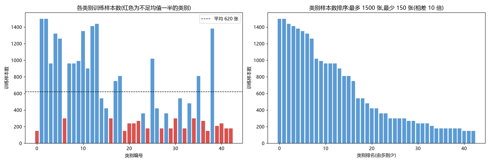
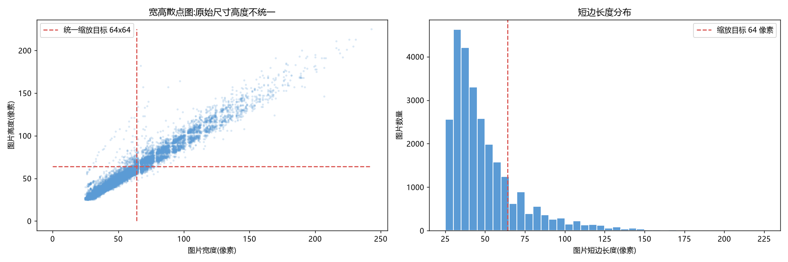
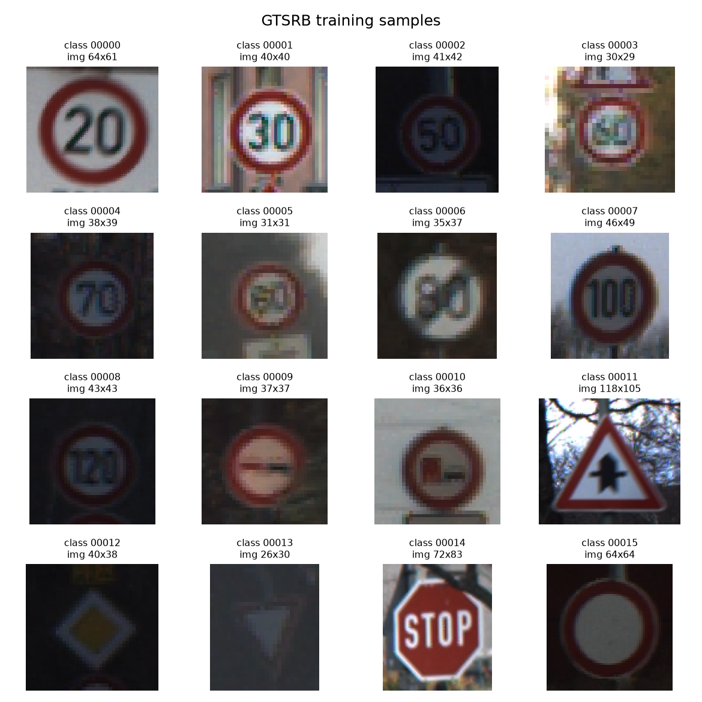
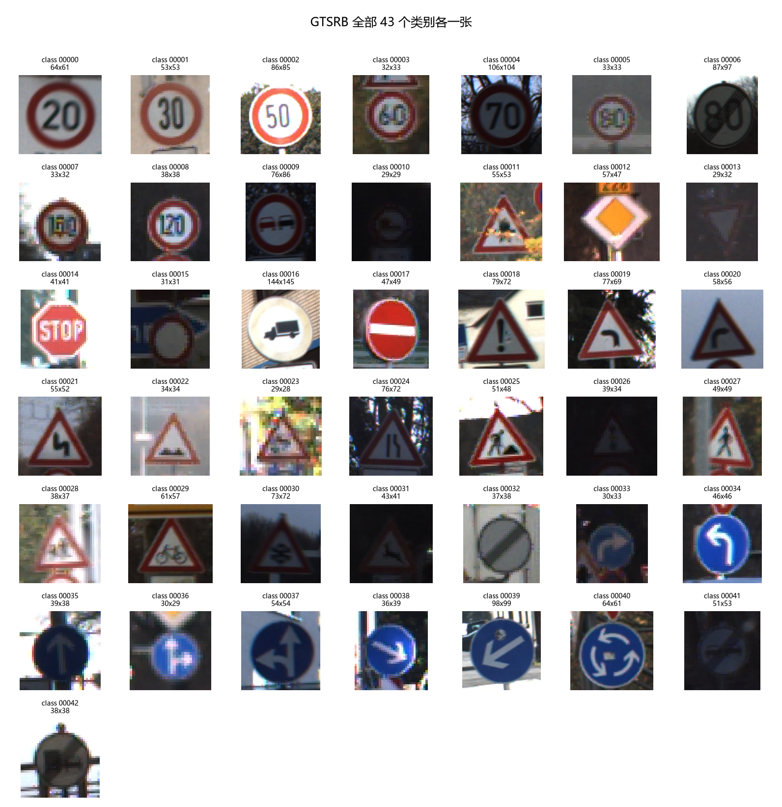
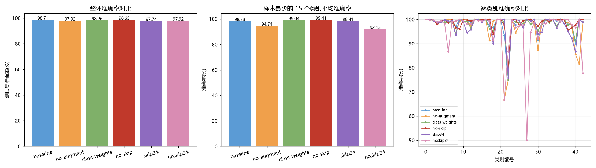
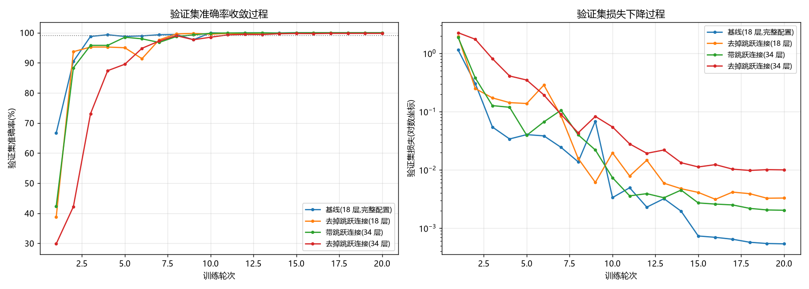
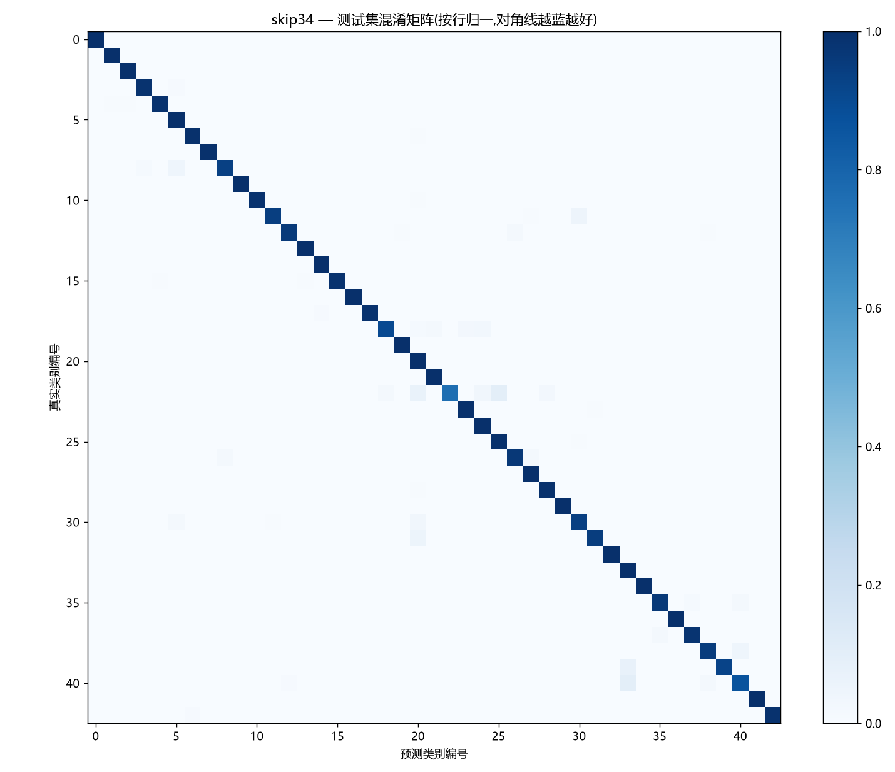
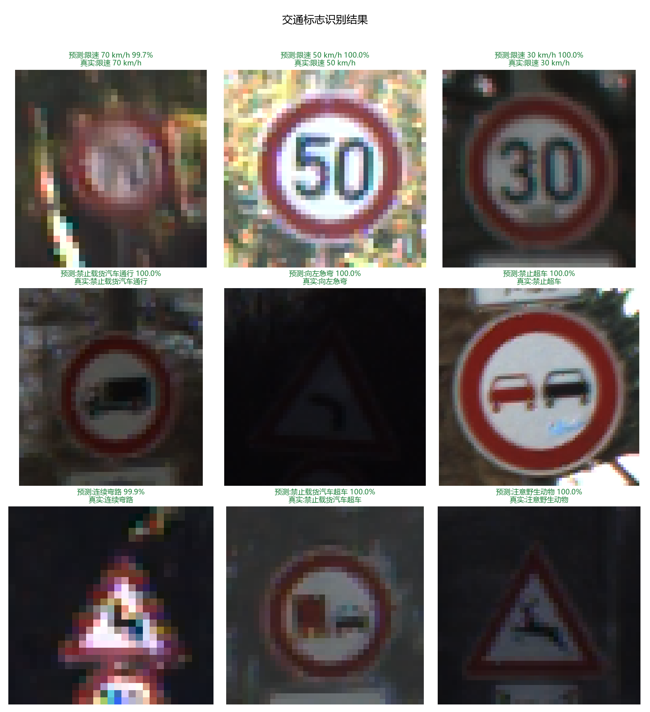
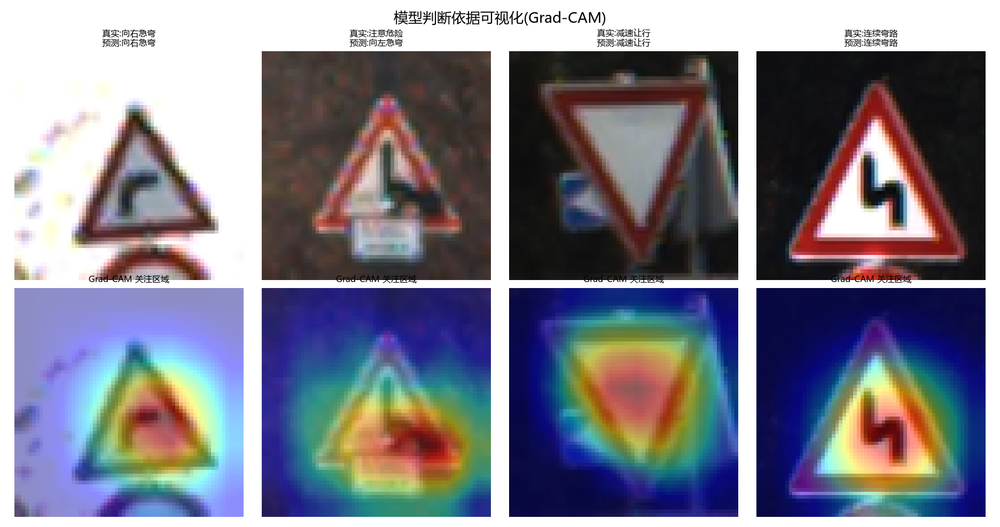

# 基于手写 ResNet 的交通标志识别

## 一、项目简介

本项目使用 PyTorch 从零搭建 ResNet,完成 43 类交通标志的识别任务。
整个流程包括数据获取与统计分析、数据预处理与增强、残差网络的实现与训练、
多组对照实验、结果评估与可视化,最终实现了一个可以对任意路牌照片进行
分类预测的推理程序。

项目全程未调用现成的网络模型,残差块与网络主体均为自己实现。

## 二、选题说明

考核给出了花卉分类、垃圾分类、植物病害分类三个参考方向,并说明参考项目
仅作参考、不推荐直接提交。因此本项目选择自主选题:交通标志识别。

选择这个方向有两个原因:

1. 交通标志识别是自动驾驶与智能车视觉感知的基础任务之一,
   与本人的智能车竞赛经历直接相关,做起来有实际体会;
2. 德国交通标志识别基准(GTSRB)是公开的经典数据集,
   类别数量多、样本分布不均衡、图片尺寸不统一,能同时体现数据分析
   与模型训练两方面的工作量。

## 三、数据集

### 3.1 来源与规模

数据来自 GTSRB(German Traffic Sign Recognition Benchmark),
官方页面为 https://benchmark.ini.rub.de/gtsrb_dataset.html 。

| 项目 | 数值 |
| --- | --- |
| 类别数 | 43 |
| 训练集 | 26640 张 |
| 测试集 | 12630 张 |
| 合计 | 39270 张 |
| 图片格式 | PPM |
| 原始尺寸 | 25×25 ~ 243×225 不等 |

下载脚本 `scripts/download_data.py` 会校验官方 MD5 后再解压,保证数据完整可信。

### 3.2 统计分析

用 Pandas 汇总全部标注文件后,得到两个直接影响后续方案的结论:

**结论一:类别严重不平衡。** 每类样本数平均 620 张、中位数 420 张,
最多的类别有 1500 张,最少的只有 150 张,相差 10 倍;
有 19 个类别(接近一半)样本数不足均值的一半。
这意味着如果不做处理,模型会明显偏向样本多的类别。

**结论二:图片尺寸高度不统一。** 宽高均值约 51×50,中位数只有 43 像素;
82.1% 的图片短边不足 64 像素,也就是说统一缩放时绝大多数是放大而非缩小。

据此确定统一输入尺寸为 **64×64**:原图中位数仅 43 像素,
使用 ImageNet 常见的 224×224 只会把小图放大数倍,既浪费算力又不会更准。





另外,在 3000 张训练图上统计出的通道均值为 (0.345, 0.315, 0.324),
明显低于 ImageNet 的 0.485,说明这批照片整体偏暗,
因此归一化参数采用本项目自己统计的结果,而不是照搬通用配置。

抽样预览(从 43 类中均匀取 16 类,每类一张):



全部 43 个类别各一张,可以直观看到各类标志的差异——
红色圆形是限速与禁令标志,三角形是警告标志,蓝色圆形是指示标志:



## 四、技术方案

### 4.1 开发环境

| 项目 | 版本 |
| --- | --- |
| Python | 3.12 |
| 包管理 | uv |
| PyTorch | 2.11.0 + CUDA 12.8 |
| 硬件 | NVIDIA RTX 5060 Laptop(8 GB 显存) |

本机原有的 Python 3.14 没有对应的 PyTorch 安装包,因此用 uv 建立了
Python 3.12 的独立环境。显卡为 Blackwell 架构(算力 sm_120),
必须使用 CUDA 12.8 及以上的构建版本,这一约束写在 `pyproject.toml` 的
`[[tool.uv.index]]` 配置里,保证换机器后 `uv sync` 能还原出同样的环境。

### 4.2 数据处理与增强

训练集按类别分层抽样切出 10% 作为验证集(23976 / 2664 张),
官方测试集只在最终评估时使用一次。

数据增强采用随机裁剪缩放、±10° 旋转、亮度对比度饱和度扰动。
这里有一个必须遵守的领域约束:**交通标志不能做水平翻转**——
"向左急弯"翻转后会变成"向右急弯",标签与图片不再对应;
同类问题也限制了旋转角度不宜过大。

### 4.3 手写 ResNet

网络结构在 `src/ai_image_classification/models.py` 中实现,
核心是基础残差块:

```
y = ReLU( F(x) + x )
```

`F(x)` 是两个 3×3 卷积加批归一化,`x` 是恒等映射。
相加的前提是形状一致,因此当通道数变化或空间尺寸减半时,
需要用 1×1 卷积把恒等映射投影到相同形状;形状本来一致时则不需要任何额外参数。

针对 64×64 的小尺寸输入,网络开头没有采用官方版本用于快速降采样的
7×7 卷积加最大池化,而是只用一个 3×3 卷积,避免小图被过度降采样。
网络由 4 个 stage 组成,layer1~layer4 的通道数为 64→128→256→512。

ResNet-18 配置下参数量约 11.19M。

### 4.4 训练流程

优化器为 AdamW,学习率 1e-3 配合余弦退火,批大小 128,训练 20 轮。
每轮结束后在验证集上评估,并按验证准确率保存最佳权重,
而不是使用最后一轮的权重。评估指标除了整体准确率,
还包括每类准确率和混淆矩阵,以便定位短板类别。

## 五、实验结果

### 5.1 四组对照实验

为保证可比性,四组实验除被考察的变量外其余设置完全一致
(同一份数据划分、20 轮、批大小 128、相同优化器与学习率)。

| 实验 | 测试集准确率 | 最稀少 15 类平均 | 最差类别准确率 |
| --- | --- | --- | --- |
| 基线(完整配置) | **98.71%** | 98.33% | 75.00% |
| 关闭数据增强 | 97.92% | 94.74% | 66.67% |
| 类别加权损失 | 98.26% | 99.04% | 75.00% |
| 去掉跳跃连接 | 98.65% | 99.41% | 79.17% |

只看最终准确率会漏掉另一个重要维度,因此同时记录了收敛速度:

| 实验 | 第 1 轮验证准确率 | 第 3 轮 | 第 5 轮 | 达到 99% 所需轮次 |
| --- | --- | --- | --- | --- |
| 基线 | 66.67% | 98.76% | 98.76% | **4** |
| 关闭数据增强 | 85.47% | 97.45% | 99.32% | 4 |
| 去掉跳跃连接 | 38.74% | 95.23% | 95.01% | **8** |
| 类别加权损失 | 26.99% | 82.77% | 98.01% | 8 |





基线的混淆矩阵(按行归一,对角线越深表示该类别识别越准):


### 5.2 深层网络对照实验

18 层网络上"去掉跳跃连接"的最终精度只差 0.06 个百分点。为验证
"网络越深、残差连接越重要"这一判断,补充了 ResNet-34 的对照实验
(层数配置 3/4/6/3,参数量约 21.30M),除深度外其余设置与 5.1 完全一致。

| 实验 | 测试准确率 | 最稀少 15 类平均 | 低于 90% 的类别数 | 最差类别准确率 |
| --- | --- | --- | --- | --- |
| skip34(带跳跃连接) | 97.74% | **98.41%** | 2 | 75.83% |
| noskip34(去掉跳跃连接) | 97.92% | 92.13% | **5** | **50.00%** |

| 实验 | 第 1 轮验证准确率 | 第 3 轮 | 第 5 轮 | 末轮验证损失 |
| --- | --- | --- | --- | --- |
| skip34 | 42.34% | 95.80% | 98.50% | 0.00203 |
| noskip34 | 29.84% | 73.09% | 89.53% | 0.01003 |

对比两者的混淆矩阵可以看出差距集中在少数类别上:




详细分析与复现方式见 `docs/实验结果.md`。

### 5.3 分析与讨论

**数据增强有效,收益集中在稀有类别。** 关闭增强后,第 1 轮验证准确率就有
85.47%,远高于基线的 66.67%——因为图片不再被随机扰动,模型记住训练样本容易得多。
但它在测试集上的整体准确率反而低了 0.79 个百分点,样本最少的 15 个类别
低了 3.59 个百分点。这是典型的过拟合:训练时表现更好,泛化能力更差。

**类别加权是整体精度与稀有类别之间的权衡。** 加权后,最稀少 15 类的平均准确率
从 98.33% 提升到 99.04%,但整体准确率从 98.71% 降到 98.26%。
模型为照顾稀有类别牺牲了一部分常见类别的表现。这说明不平衡处理没有免费的方案;
在交通标志场景下,漏检"注意冰雪""环岛"这类稀有标志的后果更严重,
因此本场景下更值得用一点整体精度去换稀有类别的召回。

**残差连接的价值首先体现在收敛速度上。** 去掉跳跃连接后,第 1 轮验证准确率
只有 38.74%,约为基线的一半;达到 99% 需要 8 轮,而基线只需 4 轮;
训练结束时的验证损失约为基线的 3 倍。也就是说,在 18 层的浅网络上,
残差结构的收益主要表现为优化更容易、收敛更快、损失更低。
这与 ResNet 原论文的观察一致:原作者对比 18 层与 34 层的普通网络时发现,
层数增加反而使训练误差变大,而残差结构能消除这种退化,深度越深作用越明显。

**少数类别是共同的短板。** 四组实验都在类别 21(连续弯路)、30(注意冰雪)、
40(环岛行驶)上出现明显下降,关闭增强的版本在类别 21 上只有 66.67%。
这些标志的共同点是训练样本少,且图案本身相似度高——都是三角形警告标志,
内部图形在 64×64 分辨率下难以区分。

**残差连接的价值随深度增加而放大。** 把深度从 18 层加到 34 层后,
同样的对比出现了清晰的差距:稀有类别平均准确率相差 6.28 个百分点,
末轮验证损失相差约 5 倍,第 3 轮验证准确率相差 22.7 个百分点。
这说明在浅网络上"看不出差别"并不代表残差结构没有作用,
而是任务太简单、网络太浅,退化现象还没发生。

**指标选择本身会影响结论。** 两组 34 层实验的整体准确率几乎相同
(97.74% 与 97.92%,去掉跳跃连接的版本甚至略高),只看这个数字会得出
"残差连接没影响"的错误结论。原因是整体准确率被样本多的类别主导,
掩盖了少数类别的塌陷。换成"低于 90% 的类别数"和"最差类别准确率",
差别立刻显现。这提醒我们在不平衡数据集上不能只汇报一个总指标。

### 5.4 推理与可解释性

推理程序对任意图片输出 top-3 类别、中文含义与置信度:



图中 9 张测试样本全部预测正确,且多数置信度接近 100%;
终端里还会逐个打印每张图的 top-3 候选与对应概率,
可以看到模型对错误选项给出的概率通常极低,这本身就是一种可信度提示。

需要说明的是,这 9 张只是随机抽样,九张全对不能当作模型整体水平的证据——
真正可信的指标是在完整测试集上评估得到的 98.71%。

Grad-CAM 用于检查模型判断时关注的区域是否合理:



热力图集中在标志牌本身而非背景,说明模型学到的是标志的图案特征。
第 2 张是被错判的样本(真实为"注意危险",预测为"向左急弯"),
热力图同样落在标志上,说明模型看的位置没错,是这两个三角形警告标志
在低分辨率下确实难以区分。

这也解释了测试集上剩余约 1.3% 的错误来自哪里:主要是少数几类
外形相近的三角形警告标志,而不是模型在"乱猜"。

## 六、创新点

1. **数据分析驱动技术决策**:输入尺寸、归一化参数、增强策略都不是照搬教程,
   而是由数据统计结果决定(中位数 43 像素、通道均值 0.33 等)。
2. **针对类别不平衡的量化对比**:用测试集数据说明加权策略的收益与代价,
   并给出场景化的取舍判断。
3. **残差连接的消融实验(18 层与 34 层两组)**:不仅比较最终精度,
   还引入收敛速度、验证损失、逐类准确率多个维度,得出两个结论:
   残差结构的收益随深度增加而放大;在不平衡数据集上只看整体准确率
   会掩盖少数类别的塌陷,指标选择本身会影响结论。
4. **可演示的推理程序与可解释性分析**:支持对任意图片输出 top-3 预测与中文含义,
   并用 Grad-CAM 验证模型关注区域是否合理。

## 七、局限与改进方向

1. **输入分辨率偏低**。64×64 在手机上演示时细节损失明显,
   可尝试 96×96 或 128×128 并配合更深的网络。
2. **存在领域差异**。模型学习的是德国交通标志,与中国路牌的设计规范不同,
   直接用于国内场景效果会显著下降。若要做实际应用,需要采集本土数据重新训练。
3. **未展开迁移学习对照**。考核对迁移学习只要求了解基本思想,
   本次受时间限制未做实验,后续可用预训练权重做一组对照,量化其提升幅度。
4. **稀有类别仍有提升空间**。可尝试重采样、Focal Loss,或针对易混类别
   (连续弯路、注意冰雪、环岛)做专门的数据增广。
5. **尚未考虑部署**。若要放到智能车等嵌入式设备上,还需做模型导出与量化,
   在精度与推理速度之间重新权衡。

## 八、个人感悟

这个项目刚开始的时候,我最迷茫的是不知道模型该怎么搭——知道要用 ResNet,
但不知道从哪里下手,也说不清每一层到底在干什么。在 AI 的辅助下,
我先确定了整体方向和技术路线,然后边做边学,才把项目跑起来。

真正让我理解模型的,其实是调试的过程。中途遇到不少问题:
检查点加载失败、去掉跳跃连接后模型结构对不上导致权重加载报错,
还有一次把"最稀少类别"的类别编号取错,图表得出了完全相反的结论。
每解决一个问题,我对代码和数据流的理解就深一层。慢慢地,
我不再只是"让代码能跑起来",而是能说清楚每一步在做什么、为什么这么做——
比如为什么输入尺寸用 64 而不是教程里的 224,为什么相加之前要检查形状是否一致。

用 AI 辅助开发的真实感受是:它帮我省下了大量写重复代码的时间,
也让我卡住的时候不会一直困在同一个问题上,攻关效率明显提高,整个过程顺利了很多。
但它不能替我做判断——方向对不对、结果合不合理、这些数字说明了什么,
最后仍然得我自己想清楚。也正因为这样,我比以前更在意"能不能把一件事讲明白"。

如果继续做下去,我想先补上迁移学习的对照实验,把输入分辨率提高到 96 或 128;
更远一点,我希望能把这套模型做量化导出,试着放到智能车上做实时识别,
把在电脑上跑通的模型真正用起来。

## 九、运行方式

```bash
# 1. 还原环境(需要已安装 uv)
uv sync
uv run scripts/check_env.py        # 确认 CUDA 与显卡可用

# 2. 获取数据并统计
uv run scripts/download_data.py
uv run scripts/analyze_data.py

# 3. 训练
uv run scripts/train.py --tag baseline --epochs 20

# 4. 评估与对比
uv run scripts/evaluate.py --tags baseline no-skip --num-workers 0
uv run scripts/compare_runs.py

# 5. 推理演示与可解释性
uv run scripts/predict.py --num-samples 9
uv run scripts/gradcam.py --num-samples 4
```

注:评估脚本在部分 Windows 环境下启动多进程会被系统拒绝,
加 `--num-workers 0` 改为单进程运行即可,结果完全一致。
